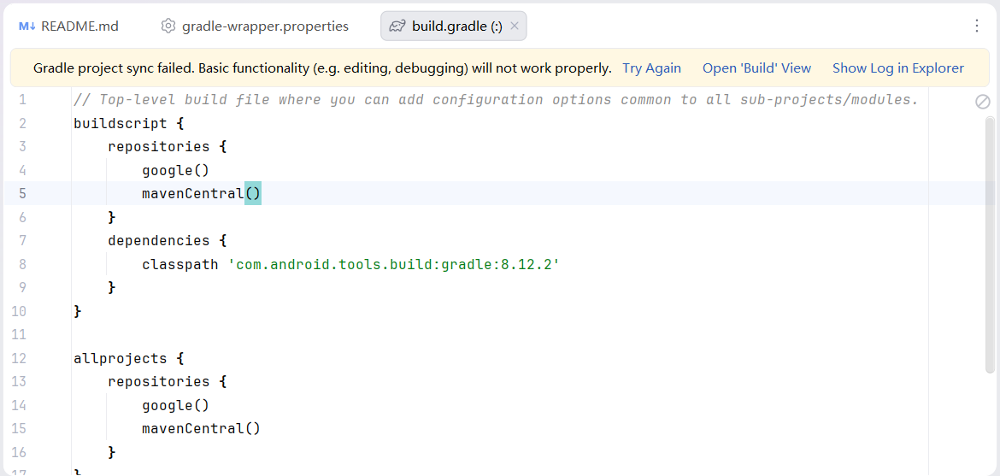
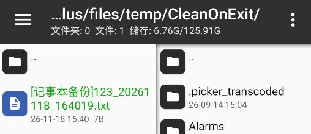
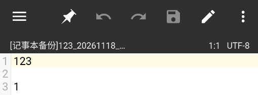
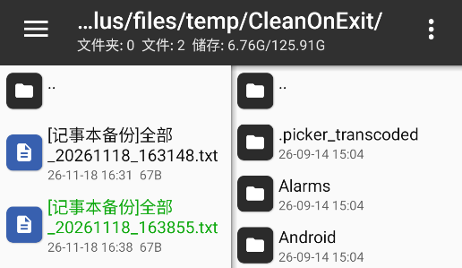
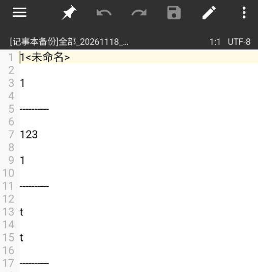

# NotePad
项目来自于官方早期的数据库操作的基本教程。
更多的解析参考[Android Sample--NotePad解析](https://blog.csdn.net/llfjfz/article/details/67638499)

# 编译时遇到的问题
时代更迭，随着Gradle版本的升级，jcenter()方法已经在Gradle 9.0 中被彻底移除。

解决方法:
在build.gradle中将jcenter()全部替换成mavenCentral()即可，一共需要替换两处。

# 已实现的功能
1.源代码已有的新增笔记、修改笔记、删除笔记

2.NoteList界面中笔记条目增加时间戳显示

3.添加笔记查询功能（根据标题或内容查询）

# 本次更新实现的功能
1.导出笔记，支持单条笔记导出和全部笔记导出
单条笔记导出效果：

全部笔记导出效果：

2.笔记的云备份和恢复，支持云端同步删除笔记

# 有待补充和优化的
测试了一下已有的功能，没什么问题，就是在主页（NoteList界面）删除某一条笔记时会卡顿，耗时比较长。

还有复制粘贴笔记功能，目前点paste只能新建一个笔记，无法复制已有的笔记，不知道是不是我的打开方式不对。

目前没有实现多选笔记导出，但是根据已有的删除、云备份功能也可以实现：先把不需要导出的云备份&仅本地删除，将剩余笔记进行全部导出，再把云备份的笔记恢复即可。